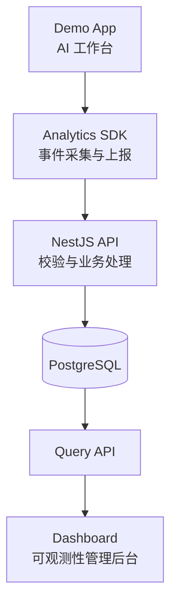

# Frontend Observability Platform

一个面向现代 Web 应用的轻量级可观测性平台，提供前端业务事件采集、运行时错误追踪、性能监控与数据分析能力。

项目以一个模拟 AI Agent 工作台的 Demo App 作为被监控应用，通过独立的 TypeScript SDK 采集遥测数据，经 NestJS 后端处理并存储到 PostgreSQL，最终在 Dashboard 中进行可视化分析。

项目不仅关注功能实现，也关注前端工程化、SDK 设计、数据质量、接口可靠性、性能优化与自动化测试。

## 项目目标

- **前端可观测性：** 采集页面访问、业务事件、运行时异常和 Web Vitals。
- **SDK 工程化：** 实现事件协议、批量上报、采样、重试、幂等与隐私过滤。
- **后端工程化：** 使用 NestJS 构建模块化 API，提供事件接收、项目管理与数据查询。
- **数据分析：** 支持事件探索、性能趋势、错误分析和基础漏斗分析。
- **现代前端工程能力：** 实践 TypeScript、国际化、性能优化、自动化测试和 Monorepo。
- **工程质量：** 通过类型检查、单元测试、集成测试和端到端测试保障系统质量。

## 系统架构



### 核心组件

| 组件 | 职责 |
|---|---|
| Demo App | 模拟 AI 工作台，产生可观测性数据 |
| Dashboard | 查看事件、性能指标、错误和分析结果 |
| Analytics SDK | 采集、处理、缓冲并上报前端遥测事件 |
| NestJS Server | 提供数据采集、项目管理和查询 API |
| PostgreSQL | 持久化项目、事件及相关分析数据 |
| Shared Types | 维护共享的 TypeScript 类型和事件协议 |

## 技术栈

| 领域 | 技术 |
|---|---|
| Monorepo | pnpm Workspaces |
| 前端 | React、TypeScript、Vite |
| 路由 | React Router |
| 服务端状态 | TanStack Query |
| UI | Tailwind CSS、shadcn/ui |
| 可视化 | Apache ECharts 或 Recharts |
| 后端 | NestJS、Node.js |
| 数据库 | PostgreSQL |
| ORM 与迁移 | Drizzle ORM、Drizzle Kit |
| SDK | TypeScript |
| 测试 | Vitest、Testing Library、Playwright |
| 代码规范 | ESLint、Prettier |

具体依赖版本以仓库中的 `package.json` 和锁文件为准。

## 项目结构

```text
frontend-observability/
├── apps/
│   ├── demo-app/             # 被监控的 AI 工作台
│   ├── dashboard/            # 可观测性管理后台
│   └── server/                # NestJS API 服务
├── packages/
│   ├── analytics-sdk/         # 前端遥测 SDK
│   └── shared-types/          # 共享类型与事件协议
├── docs/
│   ├── architecture.md        # 系统架构
│   ├── event-schema.md        # 事件协议
│   └── adr/                   # 架构决策记录
├── compose.yaml               # 本地基础设施
├── pnpm-workspace.yaml
├── package.json
└── README.md
```

## 功能规划

### 1. Analytics SDK

- 页面访问与自定义业务事件采集
- JavaScript 运行时异常采集
- Web Vitals 性能指标采集
- 事件队列与批量上报
- 失败重试与队列容量限制
- 采样、事件去重与隐私过滤
- 项目、环境和版本上下文管理

### 2. Demo App

构建一个模拟 AI Agent 工作台，用于产生和验证监控数据。

- 模拟任务创建、执行与失败
- 模拟请求延迟和接口错误
- 记录页面访问及业务操作
- 触发 JavaScript 异常
- 模拟不同语言环境
- 提供开发测试专用的异常场景

第一阶段以模拟数据和模拟任务为主，不依赖真实大模型 API。

### 3. Dashboard

- 项目管理与 SDK 接入配置
- 事件列表、筛选与详情
- 业务事件趋势分析
- Web Vitals 性能分析
- 错误列表、分组与详情
- 基础事件漏斗分析
- 中英文国际化

### 4. NestJS Server

- 健康检查与数据库就绪检查
- SDK 遥测事件接收
- 请求校验、限流与幂等处理
- 项目及配置管理
- 事件查询与统计分析
- 错误和性能数据查询

## 快速开始

### 环境要求

- Node.js：使用当前受支持的 LTS 版本，并满足项目依赖要求
- pnpm：与根目录 `packageManager` 字段指定的版本保持一致
- Docker：用于启动本地 PostgreSQL
- Git

### 1. 安装依赖

```bash
git clone <repository-url>
cd frontend-observability

pnpm install
```

将 `<repository-url>` 替换为实际仓库地址。

### 2. 配置环境变量

复制示例配置：

```bash
cp .env.example .env
```

根据本地环境调整 `DATABASE_URL` 等配置。`.env` 只用于本地开发，不应提交真实凭证。

### 3. 启动 PostgreSQL

```bash
docker compose up -d postgres
docker compose ps
```

确认数据库容器正常运行后，再执行数据库迁移。

### 4. 初始化数据库

```bash
pnpm --filter @fe-observability/server db:generate
pnpm --filter @fe-observability/server db:migrate
```

如果数据库结构尚未定义完成，先完成 Drizzle schema，再生成和执行迁移。

### 5. 启动开发服务

分别在独立终端运行：

```bash
pnpm dev:demo
```

```bash
pnpm dev:dashboard
```

```bash
pnpm dev:server
```

实际访问地址以各应用的启动日志和配置为准。

### 6. 构建项目

```bash
pnpm build
pnpm typecheck
pnpm test
```

上述命令依赖各子项目已配置相应脚本。新增应用或共享包时，应同步完善统一脚本与 CI 检查。

## 数据采集设计

SDK 通过统一的事件协议向后端上报数据。事件至少需要包含以下信息：

- `schemaVersion`：协议版本
- `eventId`：事件唯一标识
- `eventName`：事件名称
- `eventType`：事件类型
- `timestamp`：事件发生时间
- `projectId`：所属项目
- `sessionId`：匿名会话标识
- `properties`：业务扩展属性

数据接收流程：

1. SDK 生成并处理事件。
2. SDK 将事件发送到采集 API。
3. 服务端校验项目标识、字段结构和数据大小。
4. 服务端执行幂等处理并持久化事件。
5. Dashboard 通过查询 API 获取数据。

需要区分请求已接收、事件已校验、数据已持久化和数据已可查询等不同状态。

## 可靠性与安全原则

- 使用 `(project_id, event_id)` 唯一约束避免重复入库。
- 对采集请求实施结构校验、大小限制和限流。
- Dashboard 查询接口必须进行身份认证和项目级授权。
- 公开项目 Key 仅用于项目识别，不作为高权限秘密凭证。
- 默认不采集密码、访问令牌或完整 AI 对话内容。
- 为原始事件定义数据保留策略。
- 为 SDK、API 和数据库迁移编写自动化测试。

## 开发路线

- [x] 初始化 Monorepo 工程骨架
- [ ] 配置 Drizzle 与 PostgreSQL 迁移
- [ ] 实现健康检查与数据库就绪检查
- [ ] 实现首个事件采集 API
- [ ] 打通 SDK 到数据库的完整数据链路
- [ ] 实现事件查询与基础 Dashboard
- [ ] 增加 JavaScript 错误与 Web Vitals 采集
- [ ] 实现基础趋势图和漏斗分析
- [ ] 完成中英文国际化
- [ ] 完善单元、集成与端到端测试
- [ ] 建立性能基线与发布检查

## 设计原则

1. **先打通数据链路，再扩展功能。**
2. **协议先行：** 先明确事件结构和校验规则，再开发 SDK 与后端。
3. **模块化设计：** 按业务边界组织 NestJS 模块。
4. **可靠性优先：** 关注重复事件、网络失败、数据丢失和异常输入。
5. **隐私优先：** 默认最小化采集，避免收集不必要的用户内容。
6. **可验证：** 关键行为必须能够通过自动化测试验证。

## License

License 尚未确定。正式公开仓库前，请根据项目的使用与分发计划选择并添加相应许可证。
